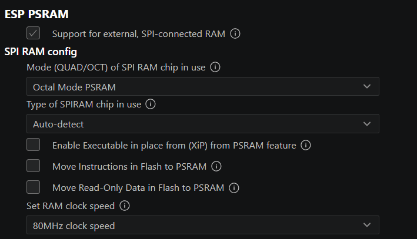
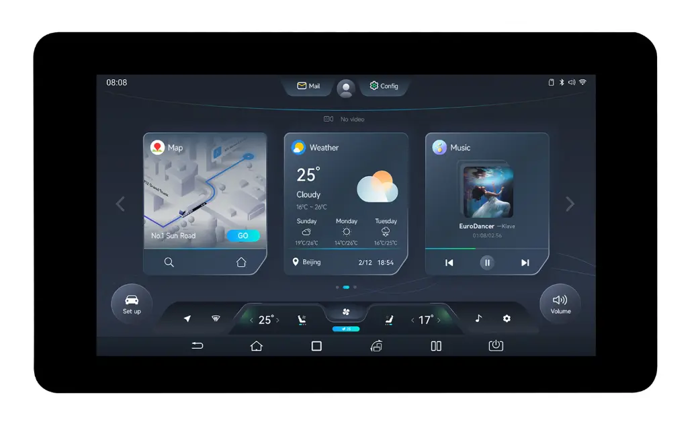

| Supported Targets | ESP32-S3 |
| ----------------- | -------- |

| Supported LCD Controller    | ST7701 |
| ----------------------------| -------|

| Supported Touch Controller  |  GT911 |
| ----------------------------| -------|

# 💡 Información del Ejemplo: RGB para Evitar Tearing (Desgarro de Imagen)

---

## 🖥️ Sobre `esp_lcd` y Drivers de Panel

El componente **`esp_lcd`** de ESP-IDF ofrece drivers listos para usar para paneles comunes (ej., ST7789, SSD1306, NT35510). Sin embargo, facilita la inclusión de drivers para otros paneles:

* **Extensibilidad:** `esp_lcd` permite al usuario **agregar drivers de panel personalizados** dentro del proyecto.
* **Reutilización:** Esto asegura que el código de alto nivel (como el porting de LVGL) pueda **reutilizarse sin cambios**, siempre y cuando el driver implementado siga la interfaz de `esp_lcd`.

---

##  Objetivo y Funcionalidad

Este ejemplo tiene dos objetivos principales:

1.  **Evitar el Tearing:** Demostrar cómo lograr una visualización fluida y **evitar el desgarro de imagen** (tearing) al usar LVGL con pantallas de interfaz **RGB**.
2.  **Demostración:** Utiliza la librería **LVGL** para renderizar un elegante reproductor de música.

---

## ⏱️ Sincronización y Seguridad de Hilos con LVGL

El porting de LVGL en este proyecto utiliza una arquitectura multihilo y sincronizada:

* **Generación de Ticks**: Se utiliza el **`esp_timer`** para generar los ticks de temporización requeridos por LVGL.
* **Manejador en Tarea Dedicada**: Se emplea una **tarea dedicada** para ejecutar la función `lv_timer_handler()`.
* **Protección con Mutex**: Dado que las APIs de LVGL **no son seguras para hilos** (not thread-safe), se utiliza un **mutex** (mecanismo de exclusión mutua) para proteger las llamadas.

> ⚠️ **IMPORTANTE:** El mutex debe **adquirirse** antes de cualquier llamada a funciones LVGL (`lv_...`) y **liberarse** después, tanto para `lv_timer_handler()` como para cualquier otra interacción con LVGL desde otras tareas o hilos.

Para más detalles sobre la integración de LVGL, consulte la [documentación oficial de porting de LVGL](https://docs.lvgl.io/master/porting/index.html).
###  Requisitos de Hardware
* Placa de desarrollo ESP32-S3R8.

* Panel LCD ST7701 con interfaz RGB y táctil GT911.

### Conexión de Hardware


Sigue el diagrama de conexión para la interfaz RGB (PCLK, DATA[15:0], HSYNC, VSYNC, DE, BK_LIGHT):

```
       ESP Board                           RGB  Panel
+-----------------------+              +-------------------+
|                   GND +--------------+GND                |
|                       |              |                   |
|                   3V3 +--------------+VCC                |
|                       |              |                   |
|                   PCLK+--------------+PCLK               |
|                       |              |                   |
|             DATA[15:0]+--------------+DATA[15:0]         |
|                       |              |                   |
|                  HSYNC+--------------+HSYNC              |
|                       |              |                   |
|                  VSYNC+--------------+VSYNC              |
|                       |              |                   |
|                     DE+--------------+DE                 |
|                       |              |                   |
|               BK_LIGHT+--------------+BLK                |
+-----------------------+              |                   |
                               3V3-----+DISP_EN            |
                                       |                   |
                                       +-------------------+
```

### Uso y Configuración
El proyecto requiere ESP-IDF (se recomienda usar v5.0 o posterior).

#### Establecer Objetivo:

```Bash

idf.py set-target esp32s3
```


#### Para configurar:
Ajusta los GPIOs y la inicialización específica del ST7701 en el archivo main/example_rgb_avoid_tearing.c.
 Asegúrate de que el soporte para PSRAM y RGB LCD panel esté activado en menuconfig.

Para que el programa fucniones debemos activa PSRAM en modo OCTAL a 80Mhz mediante el menuconfig:

 ```Bash

idf.py menuconfig
```




#### Compilar y Grabar:


```bash
idf.py -p (PUERTO) build flash monitor
```
Una animación de reproductor de música de LVGL debería aparecer en la pantalla.

### Display 
